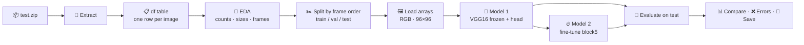

<div align="center">


# 🖐️ Hand Gesture Recognition with Transfer Learning

**Classifying 20 hand gestures with a pre-trained VGG16 CNN: feature extraction vs. fine-tuning**

[](https://colab.research.google.com/github/YOUR-USERNAME/hand-gesture-transfer-learning/blob/main/notebooks/transfer_learning_easy.ipynb)
[](https://www.python.org/)
[](https://www.tensorflow.org/)
[](https://keras.io/)
[](https://pandas.pydata.org/)
[](https://scikit-learn.org/)
[](LICENSE)

| 🎯 Test accuracy | ❌ Test errors | 🧠 Base model | 🖼️ Dataset |
|:---:|:---:|:---:|:---:|
| **100%** (fine-tuned) | **0 / 800** | VGG16 · ImageNet | 6,000 images · 20 classes |

</div>

---

## 📌 Table of Contents
- [Overview](#-overview)
- [Highlights](#-highlights)
- [Dataset](#-dataset)
- [Pipeline](#-pipeline)
- [Results](#-results)
- [Visual Gallery](#-visual-gallery)
- [Quick Start](#-quick-start)
- [Repository Structure](#-repository-structure)
- [Use the Trained Model](#-use-the-trained-model)
- [Key Learnings](#-key-learnings)
- [Limitations & Future Work](#-limitations--future-work)
- [Tech Stack](#-tech-stack)
- [Author](#-author)

---

## 🔍 Overview
Training a deep CNN from scratch needs millions of images. **Transfer learning** avoids that: we reuse **VGG16**, which already learned to see edges, curves and shapes from 1.2 million ImageNet photos, and teach it a new task, **recognising 20 hand gestures** from small black-and-white silhouettes.

The project compares two transfer learning strategies under identical conditions:

| | 🧊 Model 1: Feature Extraction | 🔥 Model 2: Fine-Tuning |
|---|---|---|
| VGG16 base | fully **frozen** | `block5` **unfrozen**, rest frozen |
| What is trained | only the new classification head | head + last VGG16 block |
| Learning rate | 0.001 | 0.00001 (100× smaller) |
| Trainable parameters | 136,468 | 7,215,892 |

The notebook is written for **beginners**. The whole dataset becomes one pandas table, **`df`**, and every step explains *what*, *why* and *what you should see*.

---

## ✨ Highlights
- 📋 **Dataset as a DataFrame:** the 6,000 images become a pandas `df` with one row per image, which makes them easy to explore, filter and split.
- 🔎 **Data-leakage detective work:** EDA shows the images are **consecutive video frames** (neighbours are about 4.5× more similar than distant frames), so the split is made **by frame order with gaps** instead of randomly.
- 🧩 **Preprocessing built into the model:** augmentation and VGG16 preprocessing live inside the Keras model, so predicting a new image takes one line.
- 📊 **Coloured result tables:** styled pandas tables for the dataset summary, split, training history, per-class reports and the model dashboard.
- 🧪 **Honest evaluation:** an untouched test set, macro precision, recall and F1, confusion matrices, error analysis and a **McNemar significance test**.
- ✅ **Fully reproducible:** fixed seeds; every number in this README comes from the executed notebook.

---

## 🗂️ Dataset
| Property | Value |
|---|---|
| Content | white hand silhouettes on a black background |
| Classes | 20 (labelled `0`–`19`) |
| Images | 6,000 JPG, **300 per class** (perfectly balanced) |
| Image size | 50 × 50 px, grayscale |
| Broken / duplicate files | 0 / 0 |

**Expected layout after unzipping `test.zip`:**
```text
test/
├── 0/   901.jpg … 1200.jpg
├── 1/
│   …
└── 19/
```

**The dataset as a table (`df`):**

| filepath | filename | label | frame | width | height | mode | split |
|---|---|---|---|---|---|---|---|
| dataset/test/0/901.jpg | 901.jpg | 0 | 901 | 50 | 50 | L | train |
| dataset/test/0/902.jpg | 902.jpg | 0 | 902 | 50 | 50 | L | train |
| … | … | … | … | … | … | … | … |

**Leakage-safe split (per class, by frame order):**
```text
frames:  |──────── train 210 ────────|gap 5|── val 40 ──|gap 5|── test 40 ──|
total:            4,200                         800                800
```

> ⚠️ The dataset is **not included** in this repository. See [`data/README.md`](data/README.md).

---

## ⚙️ Pipeline



**Model architecture:**
```text
Input (96×96×3, raw 0–255)
  → Augmentation (rotation ±18°, zoom ±10%, shift ±10%; training only, no flips)
  → VGG16 preprocessing (subtract ImageNet mean; identical to vgg16.preprocess_input for gray images)
  → VGG16 convolutional base (ImageNet weights)
  → GlobalAveragePooling2D → Dense(256, ReLU) → Dropout(0.5) → Dense(20, softmax)
```
**Training:** Adam · sparse categorical cross-entropy · batch size 32 · EarlyStopping (patience 3) · ModelCheckpoint · ReduceLROnPlateau.

---

## 🏆 Results
All results are measured on the **800 untouched test images**.

| Metric | 🧊 Feature Extraction | 🔥 Fine-Tuning |
|---|:---:|:---:|
| Training accuracy | 99.31% | 99.98% |
| Validation accuracy | 98.38% | **100.00%** |
| **Test accuracy** | 98.00% | **100.00%** |
| Precision (macro) | 0.9824 | **1.0000** |
| Recall (macro) | 0.9800 | **1.0000** |
| F1-score (macro) | 0.9802 | **1.0000** |
| Test loss | 0.0615 | **0.0008** |
| Wrong test images | 16 | **0** |
| Training time* | 21.4 min | 48.7 min (incl. Model 1) |
| Trainable parameters | 136,468 | 7,215,892 |
| Model file size | 60.6 MB | 117.2 MB |

_\* Measured on a 2-vCPU CPU machine (TensorFlow 2.21, Keras 3.15). On a Google Colab T4 GPU the whole notebook runs in roughly 10–15 minutes, and results may vary slightly._

**📈 Is the improvement real?** Fine-tuning fixed **all 16** images that feature extraction got wrong and introduced **no new errors**. McNemar's exact test gives 16 vs. 0 discordant images, *p* ≈ 0.00003, so the difference is **statistically significant**.

**🔍 Where Model 1 went wrong:** mostly gestures with spread fingers that look alike at 50×50 px: `4 → 6` (4 images), `1 → 18` (3), `7 → 6` (3) and `4 → 8` (2).

---

## 🖼️ Visual Gallery

<table>
<tr>
<td align="center"><br><sub><b>One example per class</b></sub></td>
<td align="center"><br><sub><b>Perfectly balanced: 300 images per class</b></sub></td>
</tr>
<tr>
<td align="center"><br><sub><b>Training curves: feature extraction</b></sub></td>
<td align="center"><br><sub><b>Training curves: fine-tuning</b></sub></td>
</tr>
</table>

<p align="center"><br><sub><b>Model comparison dashboard</b></sub></p>

<p align="center"><br><sub><b>Confusion matrices on the test set (left: feature extraction, right: fine-tuning)</b></sub></p>

<p align="center"><br><sub><b>The 16 test images feature extraction got wrong, all fixed by fine-tuning</b></sub></p>

---

## 🚀 Quick Start

### Option A: Google Colab (recommended)
1. Click the **Open in Colab** badge at the top.
2. `Runtime → Change runtime type → T4 GPU`.
3. `Runtime → Run all`, and upload **`test.zip`** when the upload button appears (Step 2).
4. At the end (Step 15), `my_results.zip` with all charts and tables downloads automatically.

### Option B: Run locally
```bash
git clone https://github.com/YOUR-USERNAME/hand-gesture-transfer-learning.git
cd hand-gesture-transfer-learning
pip install -r requirements.txt
# put test.zip inside notebooks/ (next to the notebook), then:
jupyter notebook notebooks/transfer_learning_easy.ipynb
```

### 🧭 The 15 steps in the notebook
| # | Step | # | Step |
|---|---|---|---|
| 1 | Load libraries | 9 | Train Model 1 |
| 2 | Upload & extract ZIP | 10 | Fine-tune (Model 2) |
| 3 | **Create `df`** | 11 | Test both models |
| 4 | Explore `df` | 12 | Find wrong predictions |
| 5 | Look at the images | 13 | Compare the models |
| 6 | Split `df` | 14 | Save & predict one image |
| 7 | Load images into arrays | 15 | Download results |
| 8 | Build Model 1 | | |

---

## 📁 Repository Structure
```text
hand-gesture-transfer-learning/
│
├── 📄 README.md                     ← you are here
├── 📄 LICENSE                       ← MIT licence
├── 📄 requirements.txt              ← Python packages
├── 📄 .gitignore                    ← keeps dataset & big model files out of Git
│
├── 📓 notebooks/
│   └── transfer_learning_easy.ipynb ← the complete, executed notebook
│
├── 📊 results/
│   ├── model_comparison.csv         ← all measured metrics
│   ├── test_predictions.csv         ← every test image: true label, predictions, confidence
│   ├── dataset_table_df.csv         ← the df table (one row per image, incl. split)
│   └── figures/                     ← all charts used in this README
│
├── 🧠 models/
│   ├── README.md                    ← how to get / use the trained models
│   └── class_names.json             ← label list, image size, model name
│
├── 🗂️ data/
│   └── README.md                    ← where to put test.zip (dataset not committed)
│
├── 📚 docs/
│   ├── TROUBLESHOOTING.md           ← common Colab / TensorFlow errors and fixes
│   └── GITHUB_UPLOAD_GUIDE.md       ← step-by-step upload instructions
│
└── 🎨 assets/
    └── banner.png                   ← README banner
```

---

## 🧠 Use the Trained Model
```python
import numpy as np, keras
from PIL import Image

model = keras.models.load_model("models/best_model.keras")   # see models/README.md to get this file

def predict(path):
    img = Image.open(path).convert("RGB").resize((96, 96), Image.BILINEAR)   # same as training
    probs = model.predict(np.array([np.array(img)]), verbose=0)[0]            # preprocessing is inside the model
    return int(probs.argmax()), float(probs.max())

label, confidence = predict("my_gesture.jpg")
print(f"Predicted class {label} ({confidence:.1%})")
```
> The input must look like the training data: a **white hand silhouette on a black background**.

---

## 💡 Key Learnings
1. **Transfer learning works even on unusual images.** ImageNet colour photos look nothing like binary silhouettes, yet a frozen VGG16 reached **98%** test accuracy with only 136K trained parameters.
2. **Fine-tuning gives the last mile.** Unfreezing one block with a tiny learning rate closed the gap to **100%**, at about 2.3× the training time and twice the file size.
3. **Explore before you split.** The images are video frames, and a random split would have leaked near-duplicates into the test set and inflated the scores.
4. **Keep preprocessing inside the model.** Training and prediction can then never use different preprocessing by accident.

---

## ⚠️ Limitations & Future Work
| Limitation | Next step |
|---|---|
| Each gesture comes from **one video**; the test set holds later frames of the same video | collect gestures from more people, hands and sessions; evaluate by recording |
| Tiny 50×50 binary images | use higher-resolution captures if available |
| Single run, single seed | repeat with several seeds and report mean ± std |
| Class labels are numbers only | add gesture names / meanings |
| VGG16 is large (117 MB) | try MobileNetV2 or EfficientNet and export to TensorFlow Lite for mobile |

---

## 🛠️ Tech Stack
<p>


</p>

---

## 📚 References
- Simonyan, K., & Zisserman, A. (2015). *Very Deep Convolutional Networks for Large-Scale Image Recognition.* ICLR.
- Deng, J., et al. (2009). *ImageNet: A Large-Scale Hierarchical Image Database.* CVPR.
- Yosinski, J., et al. (2014). *How transferable are features in deep neural networks?* NeurIPS.
- Keras guide: [Transfer learning & fine-tuning](https://keras.io/guides/transfer_learning/)

---

## 👤 Author
**YOUR NAME**
[](https://github.com/YOUR-USERNAME)
[](https://www.linkedin.com/in/YOUR-LINKEDIN/)

*Built as part of a Deep Learning course assignment on Transfer Learning with CNNs.*

<div align="center">

⭐ **If you found this project useful, please give it a star!** ⭐

</div>
